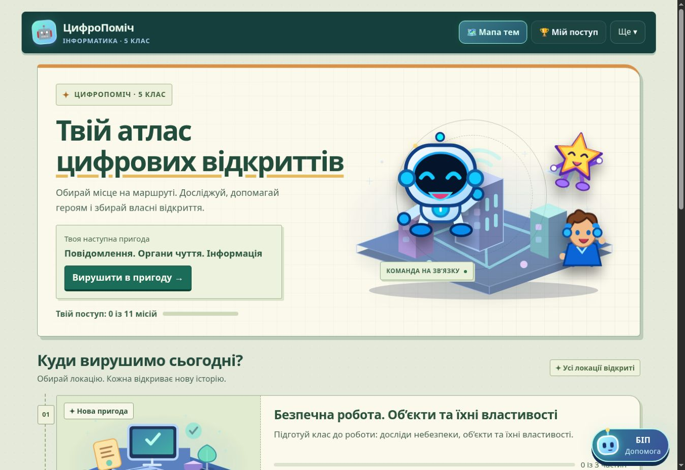
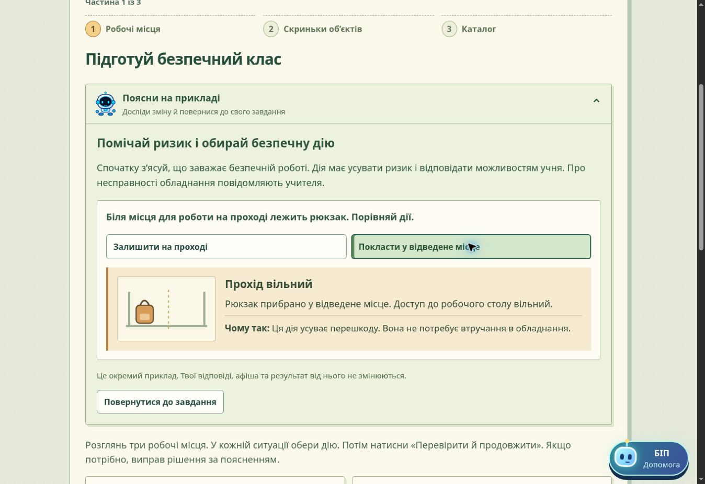

# Атлас і практичні місії · 17.11.2026

Продовження пілотної місії «Повідомлення»: спільний стиль польового щоденника поширено на мапу 5 класу та дві практичні місії. Збережено єдиний `5/game.html`, персонажів і ключі прогресу. Матеріали 7 класу не змінено.

## Результат

- Мапа — послідовність ілюстрованих зупинок з номерами, прогресом і рекомендацією, звідки продовжити.
- «Безпечна робота. Об’єкти та їхні властивості» — робочі місця, сортування карток, каталог і спостереження за переміщенням моделі.
- «Програмні об’єкти» — та сама інтерактивна афіша, читабельні інструменти й перевірка конкретної невиконаної умови.
- Сім незалежних навчальних прикладів: безпечний прохід, предмет і процес, властивість та значення, переміщення, ширина, редагування тексту, копіювання. Приклади не записують стан місії й не виконують завдання учня.
- Пояснення помилки від Кібера залишається біля завдання; кнопка відкриває схожий приклад. Після зміни відповіді застаріле пояснення прибирається.
- Правильний результат чекає явного підтвердження. Повторення не прибирає раніше отриману відзнаку.

## Перевірка

Пройдено обидві місії через інтерфейс браузера: неправильні й правильні рішення, незалежність прикладів, довільний дозволений колір, спостереження після переміщення, текст/розмір/положення, створення копії, переміщення копії, видалення, скасування. Підтвердження перед фіналом студії відновилося після перезавантаження.

Мапу, приклади й студію перевірено в iframe шириною 320 CSS-пікселів: ширина документа дорівнює доступній ширині, горизонтального переповнення немає. Це перевірка браузерного макета, не фізичних телефонів. Перевірено читабельність звіту, лабораторії й мережевої місії; знайдені старі світлі кольори інструкцій на світлому тлі виправлено.

Пройшли `tests/learning-guide.cjs`, `tests/messages.cjs`, `tests/progression.cjs`, `tests/backup.cjs`; синтаксис чотирьох змінених/нових JS-модулів перевірено Node.

Цей крок не є повним переоформленням восьми мережевих місій, звіту чи лабораторії. Їхні робочі панелі збережено. Перевірки з учнями ще не проводилися.

## Опублікована версія

GitHub Pages успішно опублікував `ed9cd334ba728b49c9b2131811b8506b97462b71`. На публічному сайті перевірено новий заголовок атласу та перемикання навчального прикладу без вибору відповідей місії.

