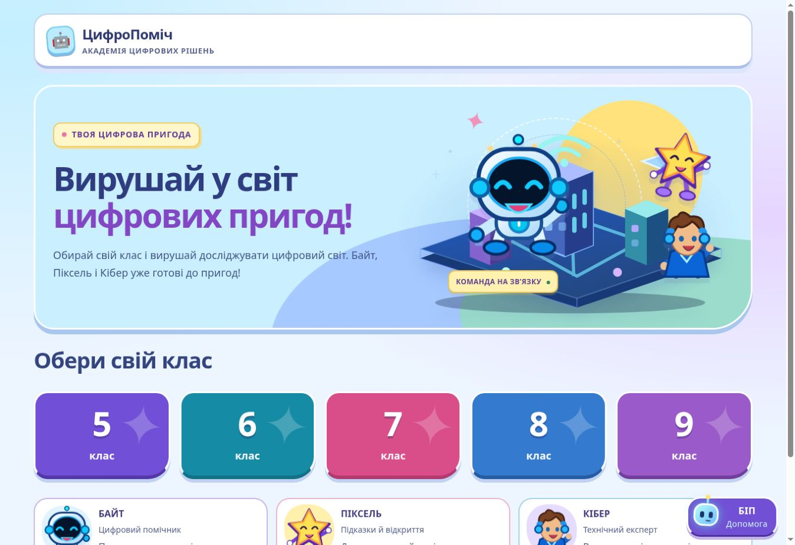
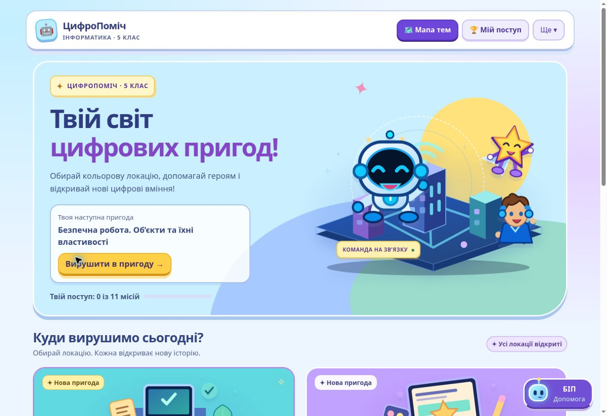
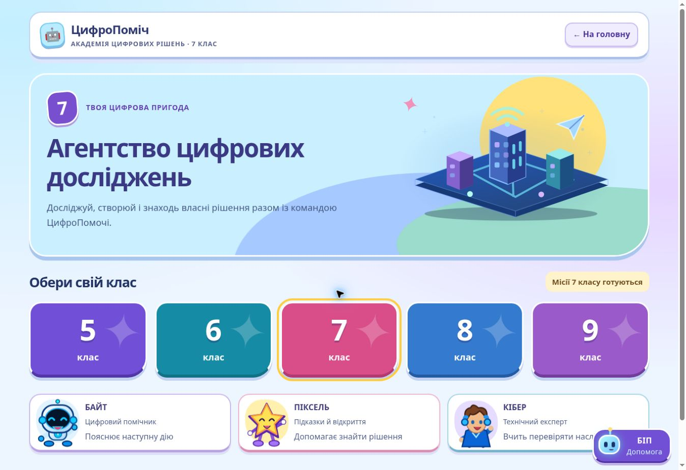

# Спільне кольорове оформлення · 17.11.2026

Виправлено розбіжність між головною, класами та місіями. Єдиний `portal-play.css` підключено останнім до головної, гри 5 класу й сторінок 6–9 класів. Окремі стилі «польового щоденника» більше не підключаються. Базовий `portal.css` збережено повністю.

Спільні елементи: блакитний фон, ілюстрований світ із сонцем і кольоровими островами, фіолетові елементи навігації, жовті основні кнопки, кольорові картки класів і локацій, світлі рамки завдань та ті самі канонічні герої. Звіт, інструктаж і мережеві місії отримали спільне оформлення зовнішніх панелей. Робочі поверхні навчальних симуляторів зберігають власний зміст і керування.

На сторінках 6–9 класів додано ілюстрації та спільний вибір класу. Ці сторінки не мали готових місій; це чесно позначено написом «Місії готуються». Нові навчальні місії для них у цьому кроці не створювалися.

Ключі збереження, резервне копіювання, перевірки відповідей і підтвердження «Далі» не змінено. В `academy.js` змінено лише назви класів оформлення й текст привітання.

Перевірено в браузері: головна, сторінки всіх класів, карта 5 класу, практичні місії, вступ і вибір відповіді мережевої місії, звіт, інструктаж, навчальні приклади. Виправлено виявлені старі світлі написи, тінь заголовків і обрізання портрета в новій світлій рамці. Перевірено явне підтвердження правильної відповіді.

На макетах шириною 320 CSS-пікселів перевірено головну, 7 клас, мапу, повідомлення та студію: горизонтального переповнення немає. Це не випробування на фізичних телефонах чи з учнями.

Пройшли наявні перевірки `progression.cjs`, `messages.cjs`, `backup.cjs`, `learning-guide.cjs`, перевірка синтаксису `academy.js`, перевірка локальних посилань і єдиного підключення нового оформлення на всіх входах.

GitHub Pages успішно опублікував `c41c1d7a601bacfa762d69c2110308bad267c527`. На публічному сайті перевірено перехід головна → 7 клас → 5 клас і спільне оформлення цих сторінок.

